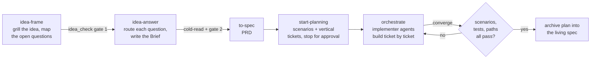

# agent-skills

Agent skills for [Claude Code](https://claude.com/claude-code) and [Codex](https://developers.openai.com/codex). They turn a raw idea into a gated, spec-driven build: each stage hands a checkable artifact to the next, and the gates are scripts, not opinions.

- **Deterministic gates.** `idea_check.py` and `converge.py` read files and exit non-zero; an agent cannot talk its way past them.
- **Agents that disagree on purpose.** `cold-read` asks a fresh reader to paraphrase a document; `orchestrate` builds with separate implementer agents and accepts a ticket only when its scenarios pass.
- **Tested.** The gate and orchestration scripts (`idea-frame`, `idea-answer`, `converge`, `cold-read`, `orchestrate`) have `unittest` suites that run in CI on Python 3.11 to 3.13, and a repo-level test lints every `SKILL.md`. `excalidraw` and `explain-video` are checked by their own render loops, not by unit tests.

## The pipeline



The full walkthrough, with the method behind each step and the findings from two backtests, is in **[docs/workflow.md](docs/workflow.md)**.

`to-spec` is an upstream skill (see [Upstream skills](#upstream-skills)). `orchestrate` delegates to workers through the [agent-runtime](https://github.com/FBisca/agent-runtime) tools.

## Skills

Own = written for this repo. Derivative = modified from an upstream, with attribution in [`THIRD_PARTY_NOTICES.md`](THIRD_PARTY_NOTICES.md).

| Skill | What it does | Origin |
|---|---|---|
| [`idea-frame`](skills/idea-frame) | Grills one raw idea into a frame and a map of the questions that change the build, then gates it | Own |
| [`idea-answer`](skills/idea-answer) | Routes every open question to whoever can answer it, keeps the Brief current, gates the commitment | Own |
| [`cold-read`](skills/cold-read) | A zero-context reader paraphrases a document to show whether it can be followed | Derivative (Google, Apache-2.0) |
| [`start-planning`](skills/start-planning) | Plans one feature from its sources to WHEN/THEN scenarios and vertical tickets, then stops for approval | Own |
| [`orchestrate`](skills/orchestrate) | Builds an approved plan with implementer agents and gates each ticket on its scenarios | Own |
| [`converge`](skills/converge) | Deterministic check of a ticket or plan against its scenarios, tests and paths | Own |
| [`excalidraw`](skills/excalidraw) | Hand-drawn Excalidraw diagrams written as a Python spec, linted and checked by rendering | Own |
| [`explain-video`](skills/explain-video) | Narrated tutorial videos built as HyperFrames films with a local voice | Own |
| [`assemble-crew`](skills/assemble-crew) | Proposes a crew for a task, including an adversary who tries to break the result | Own |
| [`deep-prompt`](skills/deep-prompt) | Deepens a task prompt with what a top professional would add before rewriting it | Own |
| [`gh-implement-from-issue`](skills/gh-implement-from-issue) | Implements a feature from a GitHub issue end to end | Own |
| [`gh-pr-create`](skills/gh-pr-create) | Opens pull requests safely with `gh` | Own |
| [`git-commit`](skills/git-commit) | Conventional Commits with project conventions | Own |
| [`handoff`](skills/handoff) | Compacts a conversation into a handoff document for another agent | Derivative (Matt Pocock, MIT) |
| [`teach`](skills/teach) | Teaches a concept inside the workspace with lessons and a learning record | Derivative (Matt Pocock, MIT) |
| [`caveman`](skills/caveman) | Ultra-compressed communication mode | Upstream copy (Matt Pocock, MIT) |
| [`zoom-out`](skills/zoom-out) | Asks for broader context on unfamiliar code | Upstream copy (Matt Pocock, MIT) |

## Install

Pick one.

**Claude Code plugin marketplace** (exposes every skill in this repo):

```
/plugin marketplace add FBisca/agent-skills
/plugin install agent-skills@fbisca-skills
```

**`npx skills`** (Claude Code, Codex and others):

```
npx skills add FBisca/agent-skills
```

**Clone and symlink**:

```bash
git clone https://github.com/FBisca/agent-skills.git
cd agent-skills
mkdir -p ~/.claude/skills ~/.agents/skills
for skill in skills/*/; do
  name="$(basename "$skill")"
  ln -sfn "$PWD/skills/$name" ~/.claude/skills/"$name"
  ln -sfn "$PWD/skills/$name" ~/.agents/skills/"$name"
done
```

`~/.claude/skills` is read by Claude Code, `~/.agents/skills` by Codex.

### Configuration

| Variable | Used by | Meaning |
|---|---|---|
| `VAULT_DIR` | `idea-frame`, `idea-answer`, `excalidraw`, `explain-video` | Root of your notes vault. Ideas live in `$VAULT_DIR/01-projects/<slug>/`. When unset, `idea_check.py` and the `excalidraw` helpers (`vault_dir()`, `style.py vault:`) exit 3 naming the variable; the other skills stop and tell you to set it. A bundled `idea-frame/templates/project.md` is used when the vault has no `90-templates/project.md`. |
| `AGENT_RUNTIME_HOME` | `orchestrate` | Checkout of [agent-runtime](https://github.com/FBisca/agent-runtime). Falls back to `agent-runtime` on `PATH`. |
| `HYPERFRAMES_SKILLS_DIR` | `explain-video` | `skills/` folder of HyperFrames v0.8.184; `skills/explain-video/scripts/fetch-hyperframes.sh` prints the export line. |

## Upstream skills

Some skills this workflow uses are maintained by others and are not copied here. [`skills.lock.json`](skills.lock.json) lists each with its source and exact install command; install them all with:

```bash
scripts/install-upstream.sh            # or: scripts/install-upstream.sh --dry-run tdd to-spec
```

| Source | Skills |
|---|---|
| [mattpocock/skills](https://github.com/mattpocock/skills) (MIT) | `codebase-design`, `diagnosing-bugs`, `domain-modeling`, `grilling`, `improve-codebase-architecture`, `prototype`, `retro`, `setup-matt-pocock-skills`, `tdd`, `to-spec`, `to-tickets`, `triage`, `writing-for-agents` |
| [pbakaus/impeccable](https://github.com/pbakaus/impeccable) (Apache-2.0) | `impeccable` (the former `frontend-design`, renamed upstream) |
| [heygen-com/hyperframes](https://github.com/heygen-com/hyperframes) (Apache-2.0) | `hyperframes`, `hyperframes-cli`, `hyperframes-registry`, `media-use` |

## Tests

```bash
scripts/run-tests.sh
```

Runs the repo contract tests (`tests/`: every `SKILL.md` has frontmatter with a `name` matching its folder and a `description`; every dropped upstream is in the lock with an install command; `VAULT_DIR` is required) and each skill's own `skills/*/tests` suite in a separate process. CI runs the same on Python 3.11, 3.12 and 3.13, plus `shellcheck` on the scripts.

## License

MIT for original work, see [`LICENSE`](LICENSE). Derived material keeps its upstream license: [`THIRD_PARTY_NOTICES.md`](THIRD_PARTY_NOTICES.md).
